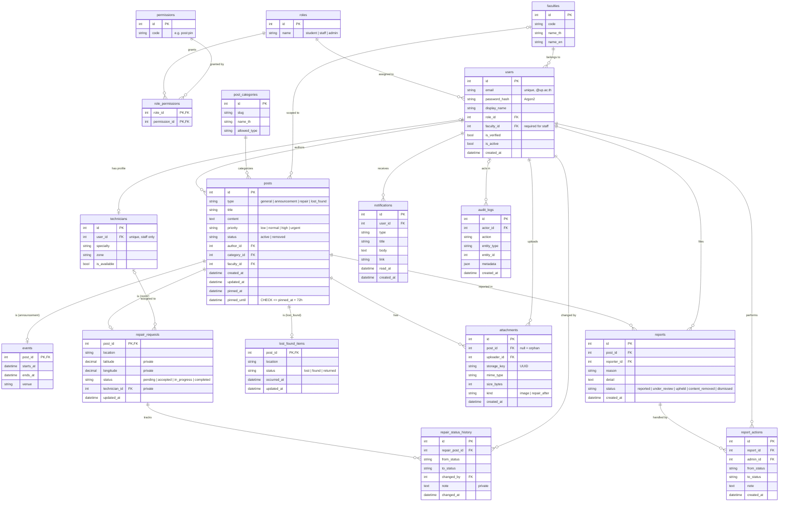

# 📐 สถาปัตยกรรมระบบ UP Board (Architecture Overview)

เอกสารในไดเรกทอรีนี้อธิบายสถาปัตยกรรม การตัดสินใจเชิงเทคนิค และโครงสร้างข้อมูลของระบบ **UP Board** — แหล่งอ้างอิงหลักคือ ADR และ API Contract หากเอกสารอื่นขัดแย้ง ให้ยึดตามสองแหล่งนี้

## 🗂️ เอกสารในไดเรกทอรีนี้

| เอกสาร | รายละเอียด |
| :--- | :--- |
| [C4 Level 1: System Context](./c4-context.md) | ผู้ใช้ 3 บทบาท ระบบ UP Board และระบบภายนอก (SMTP; University SSO เป็นแผนในอนาคต) |
| [C4 Level 2: Container](./c4-container.md) | Frontend (Vercel), Backend API (Render), Background Worker, PostgreSQL, File Storage, SMTP และ SSE |
| [Tech Stack](./tech_stack.md) | ตารางเทคโนโลยีแต่ละ Layer พร้อมเหตุผล ตัวเลือกสำรอง และ ADR ที่อ้างอิง |
| [ADR Index](./adr/README.md) | รายการบันทึกการตัดสินใจเชิงสถาปัตยกรรม ([ADR-001](./adr/001-use-restful-api-internal-commu.md), [ADR-002](./adr/002-business-rules-rbac-and-frontend-libraries.md)) |
| [API Contract](./api-contract.md) | สัญญา REST API v1 ระหว่าง Frontend และ Backend รวมถึง RBAC Matrix |
| [UML Models](./uml_models.md) | แผนภาพ UML เพิ่มเติม |

## 🧩 โมดูลของระบบ (Modules)

| โมดูล | หน้าที่โดยสรุป |
| :--- | :--- |
| **Authentication** | สมัครด้วยอีเมล `@up.ac.th` ยืนยันอีเมลด้วยการเข้าสู่ระบบ Google ครั้งแรก (ไม่ส่งอีเมล) เข้าสู่ระบบด้วย JWT (Access Token 15 นาที + Refresh Cookie) และ Hash รหัสผ่านด้วย Argon2 |
| **Dashboard** | แสดงโพสต์เป็นชั้น Pinned → Important → Upcoming → Recent ซ่อนโพสต์ทั่วไปที่เกิน 24 ชม. ณ เวลา Query |
| **Announcements / Events** | โพสต์ประกาศพร้อมเวลากิจกรรม กิจกรรมที่เริ่มภายใน 7 วันแสดงบน Dashboard เสมอ |
| **Repair Requests** | แจ้งซ่อมพร้อมรูป/ตำแหน่ง มอบหมายช่าง และติดตามสถานะ `pending → accepted → in_progress → completed` เปิดเป็นสาธารณะแต่กรองฟิลด์ส่วนตัว |
| **Lost & Found** | ประกาศของหาย/พบของ สถานะ `lost` / `found` / `returned` |
| **Reports & Moderation** | Profanity Filter (ไทย/อังกฤษ ด้วย PyThaiNLP) และการรายงานเนื้อหา `reported → under_review → upheld → content_removed` / `dismissed` (Soft Delete เท่านั้น) |
| **Notifications** | แจ้งเตือนในแอปและส่งแบบเรียลไทม์ผ่าน SSE (Stream Ticket 60 วินาที) |
| **Admin** | สถิติพื้นฐาน จัดการรายงาน และจัดการผู้ใช้ |
| **Role Management** | 3 บทบาท `student` / `staff` / `admin` โปรไฟล์ช่าง (`technicians`) ของ staff และ Bootstrap Admin จาก Environment Variables |

## 🗄️ แผนภาพฐานข้อมูล (Database ER Diagram)

ตาราง `posts` เป็น Supertype ของโพสต์ทุกประเภท โดยมีตารางย่อยแบบ 1:1 (`events`, `repair_requests`, `lost_found_items`) ที่ใช้ `post_id` เป็น Primary Key และ Foreign Key

> คอลัมน์ในแผนภาพเป็นภาพรวมระดับแนวคิด (Conceptual) อ้างอิงจาก [API Contract](./api-contract.md) — โครงสร้างจริงให้ยึดตาม Alembic Migration ในโค้ด
