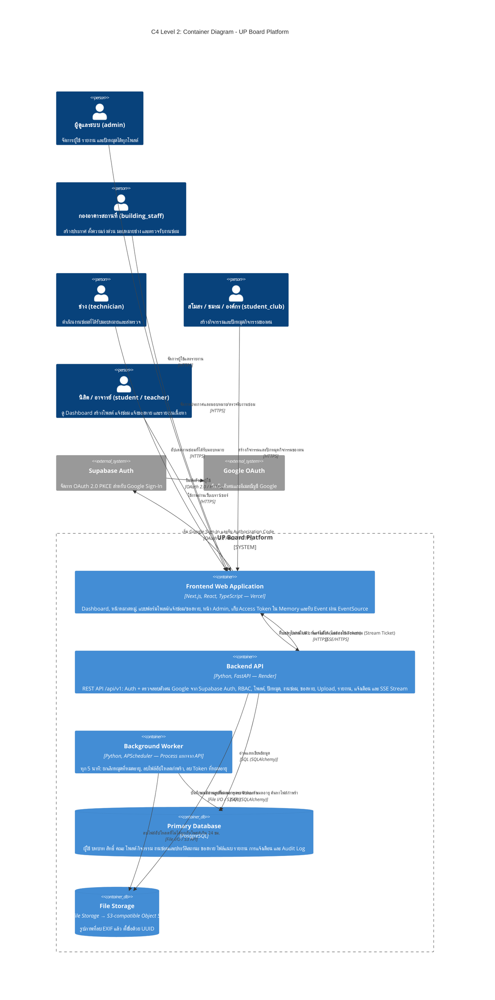

> **หมายเหตุ (ตาม [ADR-001](./adr/001-use-restful-api-internal-commu.md), [ADR-002](./adr/002-business-rules-rbac-and-frontend-libraries.md) และ [ADR-003](./adr/003-roles-repair-flow-spam-programs.md)):**
> * **Background Worker** รันเป็น Process แยกจาก API เพื่อไม่ให้ Job ทำงานซ้ำ — กฎแสดงผล 24 ชม. (Dashboard) และ 72 ชม. (ปักหมุด) บังคับที่ Query ของ Backend เสมอ Worker จึงไม่ใช่ตัวตัดสินความถูกต้อง
> * **SSE:** Frontend ขอ Ticket อายุ 60 วินาทีผ่าน `POST /stream/ticket` แล้วเปิด `GET /stream?ticket=...` เพราะ `EventSource` ส่ง Header `Authorization` ไม่ได้
> * **Google Sign-In:** Frontend ใช้ Supabase Auth ทำ OAuth 2.0 PKCE; Backend ตรวจสอบ Supabase access token และยืนยันอีเมล `@up.ac.th` ในการเข้าสู่ระบบครั้งแรก ไม่มีการส่งอีเมลยืนยันผ่าน SMTP
> * รูปภาพให้บริการผ่าน Endpoint `GET /files/{key}` ของ Backend API โดย key เป็น UUID ที่เดาไม่ได้ จึงใช้ใน `` ได้โดยไม่ต้องส่ง Token
> * **University SSO, ระบบแจ้งเตือนภายนอก (LINE / Web Push) และบริการแผนที่** ไม่อยู่ในแผนภาพนี้ เพราะอยู่นอกขอบเขตของ Release นี้ (อนาคต — ยังไม่เชื่อมต่อ)
> * **Redis ถูกนำออก** — Docker Compose (`db` + `backend` + `worker` + `frontend`) ใช้สำหรับพัฒนาบนเครื่องเท่านั้น Production ใช้ Vercel + Render
> * ไม่ระบุ Hostname, IP หรือ Port จริงตามข้อกำหนดด้านความปลอดภัยของ ADR-001
