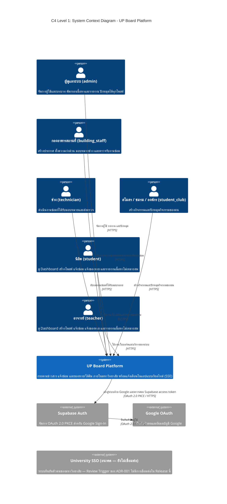

> **หมายเหตุ (ตาม [ADR-002](./adr/002-business-rules-rbac-and-frontend-libraries.md) และ [ADR-003](./adr/003-roles-repair-flow-spam-programs.md)):**
> * ระบบมี 6 บทบาท: `student`, `teacher`, `technician`, `building_staff`, `student_club` และ `admin` ตาม ADR-003
> * **Google Sign-In:** ใช้ Supabase Auth ผ่าน Google; ระบบตรวจสอบอีเมล `@up.ac.th` จากตัวตนที่ยืนยันแล้วในการเข้าสู่ระบบครั้งแรก โดยไม่มีอีเมลยืนยันผ่าน SMTP
> * **University SSO** แสดงไว้เพื่อการวางแผนเท่านั้น ยังไม่มีความสัมพันธ์ (Relationship) กับระบบ
> * ระบบแจ้งเตือนภายนอก (LINE / Web Push) และบริการแผนที่ภายนอก **อยู่นอกขอบเขต** — การแจ้งเตือนทั้งหมดเป็นแบบ In-app ผ่าน SSE และตำแหน่งงานซ่อมใช้ข้อความ + พิกัด GPS จากอุปกรณ์ของผู้แจ้ง
> * แผนภาพนี้ไม่ระบุ Hostname, IP หรือ Port จริงตามข้อกำหนดด้านความปลอดภัยของ ADR-001
