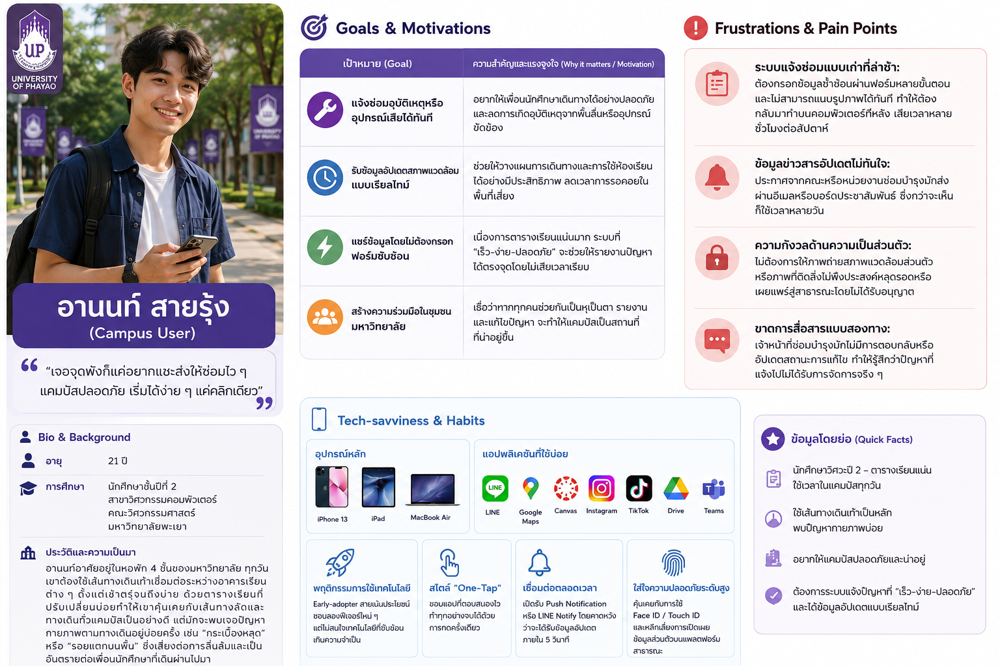
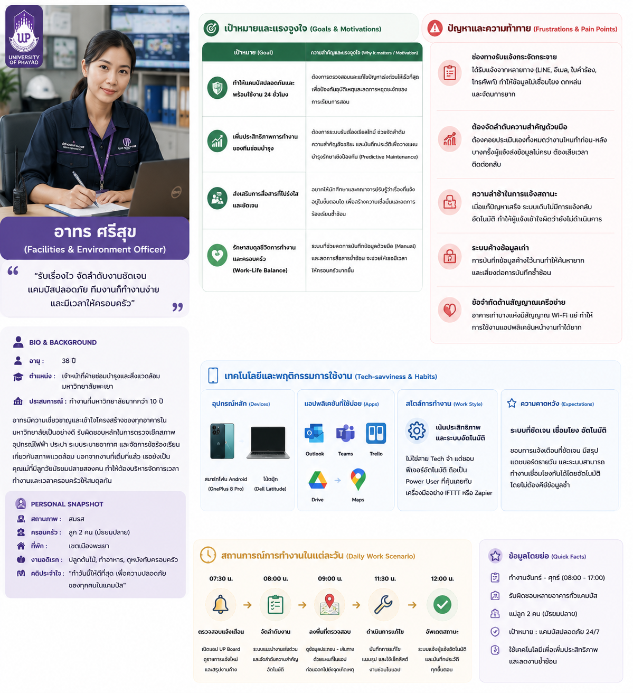
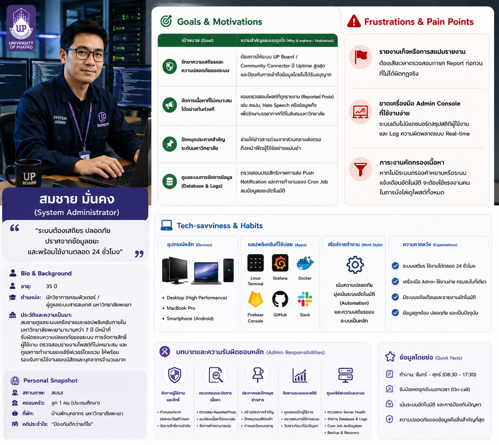
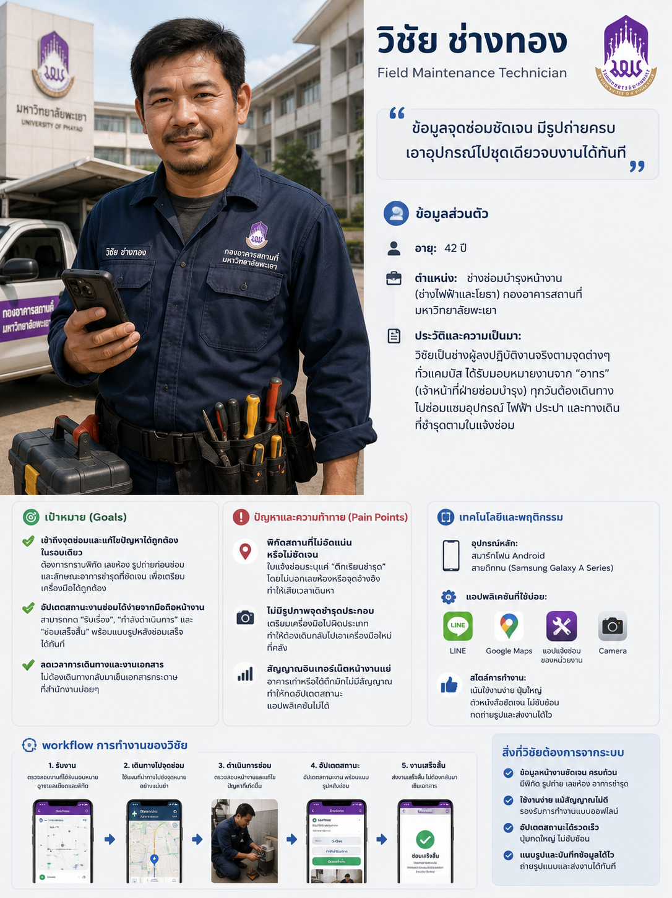

# Persona 1: อานนท์ สายรุ้ง (Campus User)
 
> "เจอจุดพังก็แค่อยากแชะส่งให้ซ่อมไว ๆ แคมปัสปลอดภัย เริ่มได้ง่าย ๆ แค่คลิกเดียว"
 
### 👤 Bio & Background
* **อายุ:** 21 ปี
* **การศึกษา:** นักศึกษาชั้นปีที่ 2 สาขาวิศวกรรมคอมพิวเตอร์ คณะวิศวกรรมศาสตร์ มหาวิทยาลัยพะเยา
* **ประวัติและความเป็นมา:** อานนท์อาศัยอยู่ในหอพัก 4 ชั้นของมหาวิทยาลัย ทุกวันเขาต้องใช้เส้นทางเดินเท้าเชื่อมต่อระหว่างอาคารเรียนต่าง ๆ ตั้งแต่เช้าตรู่จนถึงบ่าย ด้วยตารางเรียนที่ปรับเปลี่ยนบ่อยทำให้เขาคุ้นเคยกับเส้นทางลัดและทางเดินทั่วแคมปัสเป็นอย่างดี แต่มักจะพบเจอปัญหากายภาพตามทางเดินอยู่บ่อยครั้ง เช่น "กระเบื้องหลุด" หรือ "รอยแตกบนพื้น" ซึ่งเสี่ยงต่อการลื่นล้มและเป็นอันตรายต่อเพื่อนนักศึกษาที่เดินผ่านไปมา
 
### 🎯 Goals & Motivations
| เป้าหมาย (Goal) | ความสำคัญและแรงจูงใจ (Why it matters / Motivation) |
| :--- | :--- |
| **แจ้งซ่อมอุบัติเหตุหรืออุปกรณ์เสียได้ทันที** | อยากให้เพื่อนนักศึกษาเดินทางได้อย่างปลอดภัย และลดการเกิดอุบัติเหตุจากพื้นลื่นหรืออุปกรณ์ขัดข้อง |
| **รับข้อมูลอัปเดตสภาพแวดล้อมแบบเรียลไทม์** | ช่วยให้วางแผนการเดินทางและการใช้ห้องเรียนได้อย่างมีประสิทธิภาพ ลดเวลาการรอคอยในพื้นที่เสี่ยง |
| **แชร์ข้อมูลโดยไม่ต้องกรอกฟอร์มซับซ้อน** | เนื่องจากตารางเรียนแน่นมาก ระบบที่ “เร็ว-ง่าย-ปลอดภัย” จะช่วยให้รายงานปัญหาได้ตรงจุดโดยไม่เสียเวลาเรียน |
| **สร้างความร่วมมือในชุมชนมหาวิทยาลัย** | เชื่อว่าหากทุกคนช่วยกันเป็นหูเป็นตา รายงานและแก้ไขปัญหา จะทำให้แคมปัสเป็นสถานที่ที่น่าอยู่ขึ้น |
 
### 😩 Frustrations & Pain Points
* **ระบบแจ้งซ่อมแบบเก่าที่ล่าช้า:** ต้องกรอกข้อมูลซ้ำซ้อนผ่านฟอร์มหลายขั้นตอน และไม่สามารถแนบรูปภาพได้ทันที ทำให้ต้องกลับมาทำบนคอมพิวเตอร์ทีหลัง เสียเวลาหลายชั่วโมงต่อสัปดาห์
* **ข้อมูลข่าวสารอัปเดตไม่ทันใจ:** ประกาศจากคณะหรือหน่วยงานซ่อมบำรุงมักส่งผ่านอีเมลหรือบอร์ดประชาสัมพันธ์ ซึ่งกว่าจะเห็นก็ใช้เวลาหลายวัน
* **ความกังวลด้านความเป็นส่วนตัว:** ไม่ต้องการให้ภาพถ่ายสภาพแวดล้อมส่วนตัว หรือภาพที่ติดสิ่งไม่พึงประสงค์หลุดรอดหรือเผยแพร่สู่สาธารณะโดยไม่ได้รับอนุญาต
* **ขาดการสื่อสารแบบสองทาง:** เจ้าหน้าที่ซ่อมบำรุงมักไม่มีการตอบกลับหรืออัปเดตสถานะการแก้ไข ทำให้รู้สึกว่าปัญหาที่แจ้งไปไม่ได้รับการจัดการจริง ๆ
 
### 📱 Tech-savviness & Habits
* **อุปกรณ์หลัก:** สมาร์ทโฟน (iPhone 13), แท็บเล็ต (iPad) และแล็ปท็อป (MacBook Air)
* **แอปพลิเคชันที่ใช้บ่อย:** LINE, Google Maps, Canvas, Instagram, TikTok, Google Drive, Microsoft Teams
* **พฤติกรรมการใช้เทคโนโลยี:** Early-adopter สายเน้นประโยชน์ ชอบลองฟีเจอร์ใหม่ ๆ แต่ไม่สนใจเทคโนโลยีที่ซับซ้อนเกินความจำเป็น
* **สไตล์ "One-Tap":** ชอบแอปที่ตอบสนองไว ทำทุกอย่างจบได้ด้วยการกดครั้งเดียว
* **เชื่อมต่อตลอดเวลา:** เปิดรับ Push Notification หรือ LINE Notify โดยคาดหวังว่าจะได้รับข้อมูลอัปเดตภายใน 5 วินาที
* **ใส่ใจความปลอดภัยระดับสูง:** คุ้นเคยกับการใช้ Face ID/Touch ID และหลีกเลี่ยงการเปิดเผยข้อมูลส่วนตัวบนแพลตฟอร์มสาธารณ

---

# 👩‍🔧 Persona 2: อาทร ศรีสุข (Facilities & Environment Officer) 
> "รับเรื่องไว จัดลำดับงานชัดเจน แคมปัสปลอดภัย ทีมงานก็ทำงานง่ายและมีเวลาให้ครอบครัว"

### 👤 Bio & Background
* **อายุ:** 38 ปี
* **ตำแหน่ง:** เจ้าหน้าที่ฝ่ายซ่อมบำรุงและสิ่งแวดล้อม มหาวิทยาลัยพะเยา
* **ประวัติและความเป็นมา:** อาทรทำงานที่มหาวิทยาลัยมานานกว่า 10 ปี มีความเชี่ยวชาญและเข้าใจโครงสร้างของทุกอาคารเป็นอย่างดี รับผิดชอบหลักในการตรวจเช็คสภาพอุปกรณ์ไฟฟ้า ประปา ระบายอากาศ และจัดการข้อร้องเรียนเกี่ยวกับสภาพแวดล้อม นอกจากงานที่เต็มที่แล้ว เธอยังเป็นคุณแม่ที่มีลูกวัยมัธยมปลายสองคน ทำให้ต้องบริหารจัดการเวลาทำงานและเวลาครอบครัวให้สมดุลกัน
 
### 🎯 Goals & Motivations
| เป้าหมาย (Goal) | ความสำคัญและแรงจูงใจ (Why it matters / Motivation) |
| :--- | :--- |
| **ทำให้แคมปัสปลอดภัยและพร้อมใช้งาน 24 ชั่วโมง** | ต้องการตรวจสอบและแก้ไขปัญหาเร่งด่วนให้เร็วที่สุด เพื่อป้องกันอุบัติเหตุและลดการหยุดชะงักของการเรียนการสอน |
| **เพิ่มประสิทธิภาพการทำงานของทีมซ่อมบำรุง** | ต้องการระบบรับเรื่องเรียลไทม์ ช่วยจัดลำดับความสำคัญอัจฉริยะ และบันทึกประวัติเพื่อวางแผนบำรุงรักษาเชิงป้องกัน (Predictive Maintenance) |
| **ส่งเสริมการสื่อสารที่โปร่งใสและชัดเจน** | อยากให้นักศึกษาและคณาจารย์รับรู้ว่าเรื่องที่แจ้งอยู่ในขั้นตอนใด เพื่อสร้างความเชื่อมั่นและลดการร้องเรียนซ้ำซ้อน |
| **รักษาสมดุลชีวิตการทำงานและครอบครัว (Work-Life Balance)** | ระบบที่ช่วยลดการบันทึกข้อมูลด้วยมือ (Manual) และลดการสื่อสารซ้ำซ้อน จะช่วยให้เธอมีเวลาให้ครอบครัวมากขึ้น |
 
### 😩 Frustrations & Pain Points
* **ช่องทางรับแจ้งกระจัดกระจาย:** ได้รับแจ้งจากหลายทาง (LINE, อีเมล, ใบคำร้อง, โทรศัพท์) ทำให้ข้อมูลไม่เชื่อมโยง ตกหล่น และจัดการยาก
* **ต้องจัดลำดับความสำคัญด้วยมือ:** ต้องคอยประเมินเองทั้งหมดว่างานไหนทำก่อน-หลัง บางครั้งผู้แจ้งส่งข้อมูลไม่ครบ ต้องเสียเวลาติดต่อกลับ
* **ความล่าช้าในการแจ้งสถานะ:** เมื่อแก้ปัญหาเสร็จ ระบบเดิมไม่มีการแจ้งกลับอัตโนมัติ ทำให้ผู้แจ้งเข้าใจผิดว่ายังไม่ดำเนินการ
* **ระบบค้างข้อมูลเก่า:** การบันทึกข้อมูลค้างไว้นานทำให้ค้นหายาก และเสี่ยงต่อการบันทึกซ้ำซ้อน
* **ข้อจำกัดด้านสัญญาณเครือข่าย:** อาคารเก่าบางแห่งมีสัญญาณ Wi-Fi แย่ ทำให้การใช้งานแอปพลิเคชันหน้างานทำได้ยาก
 
### 📱 Tech-savviness & Habits
* **อุปกรณ์หลัก:** สมาร์ทโฟน Android ระดับกลาง (OnePlus 8 Pro) และ โน้ตบุ๊ก (Dell Latitude)
* **แอปพลิเคชันที่ใช้บ่อย:** Outlook, Microsoft Teams, Trello, Google Drive, Google Maps
* **สไตล์การทำงาน (เน้นประสิทธิภาพและระบบอัตโนมัติ):** ไม่ใช่สาย Tech จ๋า แต่ชอบฟีเจอร์อัตโนมัติ ถือเป็น Power User ที่คุ้นเคยกับเครื่องมืออย่าง IFTTT หรือ Zapier
* **ความคาดหวัง:** ชอบการแจ้งเตือนที่ชัดเจน มีสรุปแดชบอร์ดรายวัน และระบบสามารถทำงานเชื่อมโยงกันได้โดยอัตโนมัติโดยไม่ต้องคีย์ข้อมูลซ้ำ

---

# 👨‍💼 Persona 3: สมชาย มั่นคง (System Administrator)

> "ระบบต้องเสถียร ปลอดภัย ปราศจากข้อมูลขยะ และพร้อมใช้งานตลอด 24 ชั่วโมง"

### 👤 Bio & Background
* **อายุ:** 35 ปี
* **ตำแหน่ง:** นักวิชาการคอมพิวเตอร์ / ผู้ดูแลระบบสารสนเทศ มหาวิทยาลัยพะเยา
* **ประวัติและความเป็นมา:** สมชายดูแลระบบเครือข่ายและแอปพลิเคชันภายในมหาวิทยาลัยมานานกว่า 7 ปี มีหน้าที่รับผิดชอบความปลอดภัยของระบบ การจัดการสิทธิ์ผู้ใช้งาน ตรวจสอบรายงานโพสต์ที่ไม่เหมาะสม และดูแลการทำงานของเซิร์ฟเวอร์โดยรวม ให้พร้อมรองรับการใช้งานของนิสิตและบุคลากรจำนวนมาก

### 🎯 Goals & Motivations
| เป้าหมาย (Goal) | ความสำคัญและแรงจูงใจ (Why it matters / Motivation) |
| :--- | :--- |
| **รักษาความเสถียรและความปลอดภัยของระบบ** | ต้องการให้ระบบ UP Board / Community Connector มี Uptime สูงสุด และป้องกันการเข้าถึงข้อมูลโดยไม่ได้รับอนุญาต |
| **จัดการเนื้อหาที่ไม่เหมาะสมได้อย่างทันท่วงที** | คอยตรวจสอบโพสต์ที่ถูกรายงาน (Reported Posts) เช่น สแปม, Hate Speech หรือข้อมูลเท็จ เพื่อรักษาบรรยากาศที่ดีในสังคมมหาวิทยาลัย |
| **ปักหมุดประกาศสำคัญระดับมหาวิทยาลัย** | ช่วยให้ข่าวสารด่วนจากส่วนกลางส่งตรงถึงหน้าฟีดผู้ใช้อย่างแม่นยำ |
| **ดูแลระบบการจัดการข้อมูล (Database & Logs)** | ตรวจสอบประสิทธิภาพการส่ง Push Notification และการทำงานของ Cron Job ลบข้อมูลขยะอัตโนมัติ |

### 😩 Frustrations & Pain Points
* **รายงานเท็จหรือการสแปมรายงาน:** ต้องเสียเวลาตรวจสอบการกด Report ก่อกวนที่ไม่ได้ผิดกฎจริง
* **ขาดเครื่องมือ Admin Console ที่ใช้งานง่าย:** ระบบเดิมไม่มีแดชบอร์ดสรุปสถิติผู้ใช้งานและ Log ความผิดพลาดแบบ Real-time
* **ภาระงานคัดกรองเนื้อหา:** หากไม่มีระบบกรองคำหยาบหรือระบบแจ้งเตือนอัตโนมัติ จะต้องใช้แรงงานคนในการนั่งไล่ดูโพสต์ทั้งหมด

### 📱 Tech-savviness & Habits
* **อุปกรณ์หลัก:** คอมพิวเตอร์เดสก์ท็อปประสิทธิภาพสูง, MacBook Pro, สมาร์ทโฟน Android
* **แอปพลิเคชันที่ใช้บ่อย:** Linux Terminal, Grafana, Docker, Firebase Console, GitHub, Slack
* **สไตล์การทำงาน:** เน้นความปลอดภัย มุ่งเน้นระบบอัตโนมัติ (Automation) และความเสถียรของระบบเป็นหลัก

---

# 🛠️ Persona 4: วิชัย ช่างทอง (Field Maintenance Technician)

> "ข้อมูลจุดซ่อมชัดเจน มีรูปถ่ายครบ เอาอุปกรณ์ไปชุดเดียวจบงานได้ทันที"

### 👤 Bio & Background
* **อายุ:** 42 ปี
* **ตำแหน่ง:** ช่างซ่อมบำรุงหน้างาน (ช่างไฟฟ้าและโยธา) กองอาคารสถานที่ มหาวิทยาลัยพะเยา
* **ประวัติและความเป็นมา:** วิชัยเป็นช่างผู้ลงปฏิบัติงานจริงตามจุดต่างๆ ทั่วแคมปัส ได้รับมอบหมายงานจาก "อาทร" (เจ้าหน้าที่ฝ่ายซ่อมบำรุง) ทุกวันต้องเดินทางไปซ่อมแซมอุปกรณ์ ไฟฟ้า ประปา และทางเดินที่ชำรุดตามใบแจ้งซ่อม

### 🎯 Goals & Motivations
| เป้าหมาย (Goal) | ความสำคัญและแรงจูงใจ (Why it matters / Motivation) |
| :--- | :--- |
| **เข้าถึงจุดซ่อมและแก้ไขปัญหาได้ถูกต้องในรอบเดียว** | ต้องการทราบพิกัด เลขห้อง รูปถ่ายก่อนซ่อม และลักษณะอาการชำรุดที่ชัดเจน เพื่อเตรียมเครื่องมือได้ถูกต้อง |
| **อัปเดตสถานะงานซ่อมได้ง่ายจากมือถือหน้างาน** | สามารถกด "รับเรื่อง", "กำลังดำเนินการ" และ "ซ่อมเสร็จสิ้น" พร้อมแนบรูปหลังซ่อมเสร็จได้ทันที |
| **ลดเวลาการเดินทางและงานเอกสาร** | ไม่ต้องเดินทางกลับมาเซ็นเอกสารกระดาษที่สำนักงานบ่อยๆ |

### 😩 Frustrations & Pain Points
* **พิกัดสถานที่ไม่อัดแน่นหรือไม่ชัดเจน:** ใบแจ้งซ่อมระบุแค่ "ตึกเรียนชำรุด" โดยไม่บอกเลขห้องหรือจุดอ้างอิง ทำให้เสียเวลาเดินหา
* **ไม่มีรูปภาพจุดชำรุดประกอบ:** เตรียมเครื่องมือไปผิดประเภท ทำให้ต้องเดินกลับไปเอาเครื่องมือใหม่ที่คลัง
* **สัญญาณอินเทอร์เน็ตหน้างานแย่:** อาคารเก่าหรือใต้ตึกมักไม่มีสัญญาณ ทำให้กดอัปเดตสถานะแอปพลิเคชันไม่ได้

### 📱 Tech-savviness & Habits
* **อุปกรณ์หลัก:** สมาร์ทโฟน Android สายถึกทน (Samsung Galaxy A Series)
* **แอปพลิเคชันที่ใช้บ่อย:** LINE,Google Maps, แอปแจ้งซ่อมของหน่วยงาน, Camera
* **สไตล์การทำงาน:** เน้นใช้งานง่าย ปุ่มใหญ่ ตัวหนังสือชัดเจน ไม่ซับซ้อน กดถ่ายรูปและส่งงานได้ไว